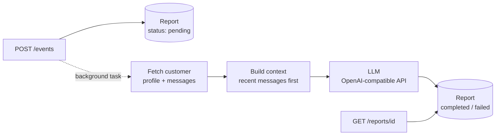

# AI Report Service


An event-driven FastAPI service that turns an incoming customer event (for example a phone call) into an **AI-generated report** for the advisor who picks up: a short summary, sales opportunities and a suggested opener.

It shows how to put a language model inside a real backend: fetching data from other systems, building a clean context, calling the model, and storing the result with proper error handling.

## How it works



1. `POST /events` stores a `pending` report and answers `202 Accepted` right away.
2. A background task loads the customer profile and recent e-mails from the customer source.
3. The data is turned into a compact, deterministic context (most recent messages first, whitespace cleaned).
4. The model generates a Markdown report with fixed sections.
5. The report is saved as `completed`, or as `failed` with a clear reason (unknown customer, model error, timeout). Internal error details are never exposed.

## Features

- Async FastAPI + SQLAlchemy 2.0 (PostgreSQL in Docker, SQLite locally)
- Works with any **OpenAI-compatible** endpoint: OpenAI, Mistral, or a local Ollama server
- A `fake` LLM provider so the project runs and is tested without an API key
- Rejected reports are stored with their reason instead of being lost
- 17 tests (API, context building, LLM client with mocked HTTP), Ruff lint, GitHub Actions CI
- Docker image running as a non-root user, `docker compose` with PostgreSQL

## Quick start

**With Docker** (API + PostgreSQL):

```bash
cp .env.example .env
docker compose up --build
```

**Without Docker:**

```bash
python -m venv .venv && source .venv/bin/activate
pip install -e ".[dev]"
uvicorn app.main:app --reload
```

Then open the interactive docs at http://localhost:8000/docs.

## Try it

```bash
curl -X POST localhost:8000/events \
  -H "Content-Type: application/json" \
  -d '{"type": "incoming_call", "customer_id": "C-1001"}'
# {"report_id": "05dfc935-...", "status": "pending"}

curl localhost:8000/reports/05dfc935-...
```

```json
{
  "id": "05dfc935-...",
  "customer_id": "C-1001",
  "event_type": "incoming_call",
  "status": "completed",
  "content": "## Summary\n...\n\n## Opportunities\n...\n\n## Suggested opener\n...",
  "error": null
}
```

Sample customers `C-1001` and `C-1002` live in `app/data/customers.json`. Any other id produces a `failed` report with the reason `Customer ... not found`.

## Use a real model

In `.env`:

```bash
LLM_PROVIDER=openai
LLM_API_KEY=sk-...
LLM_MODEL=gpt-4o-mini
# Or a local model with Ollama:
# LLM_BASE_URL=http://localhost:11434/v1
# LLM_MODEL=llama3.1
```

## API

| Method | Path | Description |
|---|---|---|
| `POST` | `/events` | Receive an event, return `202` with the report id |
| `GET` | `/reports/{id}` | Get one report and its status |
| `GET` | `/reports?customer_id=` | List recent reports, optionally for one customer |
| `GET` | `/health` | Health check |

## Project structure

```
app/
├── main.py            # app factory and lifespan (DB, LLM client, pipeline)
├── api.py             # HTTP routes
├── config.py          # settings from environment variables
├── models.py          # SQLAlchemy Report model
├── schemas.py         # Pydantic request/response models
├── data/customers.json
└── services/
    ├── crm.py         # customer data source (stands in for internal APIs)
    ├── context.py     # builds the prompt context
    ├── llm.py         # fake + OpenAI-compatible clients
    └── pipeline.py    # the report workflow and error handling
tests/
```

## Tests

```bash
pytest -v
ruff check . && ruff format --check .
```

## Next steps

- Replace FastAPI background tasks with a queue (Redis + a worker) for retries
- Alembic migrations
- Structured JSON logs and metrics
